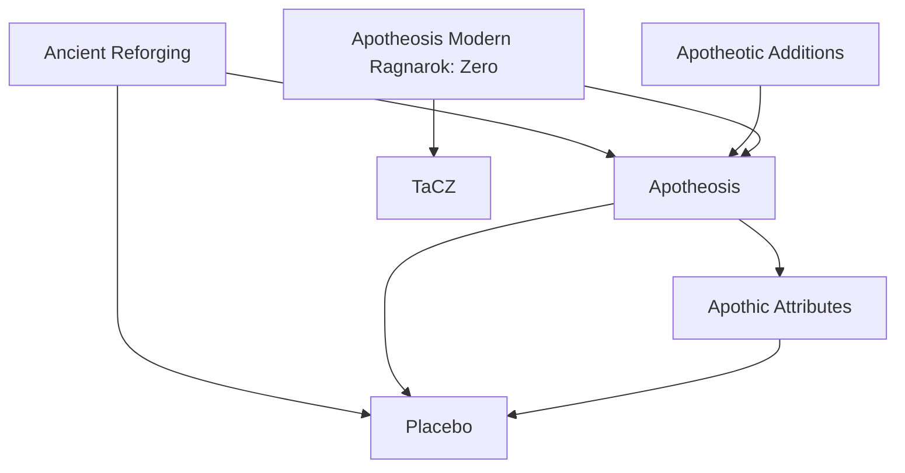
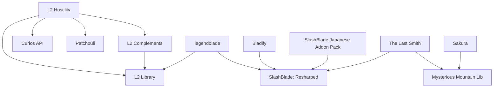
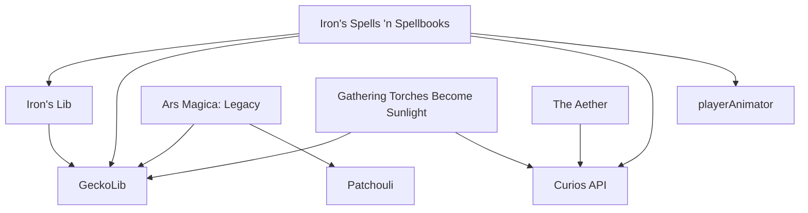
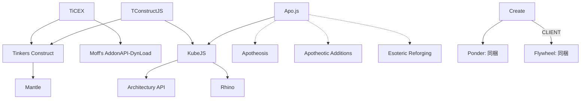
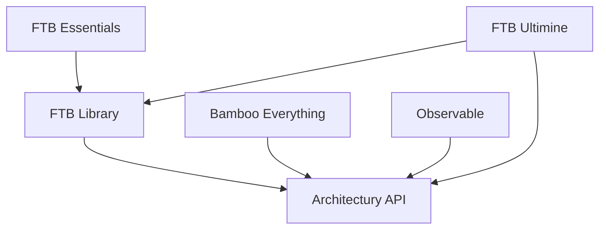
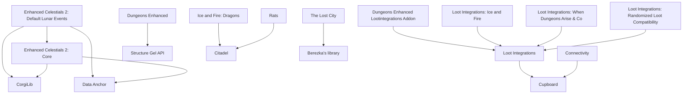
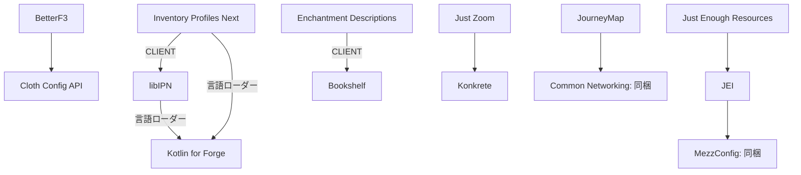
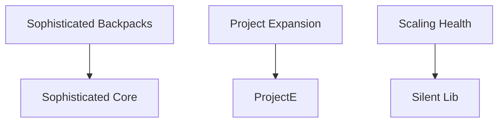

# minecraft-modpack

## Mod構成

- パック名: Yaminabe Modpack
- Minecraft: **1.20.1**
- Forge: **47.4.10**
- 管理方式: [packwiz](https://packwiz.infra.link/)、Mod定義は [`public/mods/`](public/mods/)
- 登録数: **131個**（JAR内に同梱されたMod・ライブラリは別枠）

## 目次

- [依存関係の読み方・調査範囲](#依存関係の読み方調査範囲)
- [先に確認したい点](#先に確認したい点)
- [主要な依存チェーン](#主要な依存チェーン)
- [依存関係グラフ](#依存関係グラフ)
- [必須依存の一覧](#必須依存の一覧)
- [前提Modから見た利用先](#前提modから見た利用先)
- [任意の依存・併用時制約](#任意の依存併用時制約)
- [JAR内に同梱されるMod・ライブラリ](#jar内に同梱されるmodライブラリ)
- [外部Modの必須依存宣言がないもの](#外部modの必須依存宣言がないもの)
- [構成変更時の注意](#構成変更時の注意)

## 依存関係の読み方・調査範囲

2026-10-18時点の `public/mods/*.pw.toml` が指定する131個のJARを取得し、定義ファイルのSHA-1と一致することを確認してから、`META-INF/mods.toml`、`META-INF/MANIFEST.MF`、`META-INF/jarjar/metadata.json` および同梱JARのMod定義を調査した。配布サイトの最新バージョンではなく、**このパックで指定したファイル**を対象にしている。

- **必須**: `mandatory = true` の依存、および `modLoader` が要求する言語ローダー。
- **任意**: `mandatory = false` の宣言。機能連携のほか、併用時のバージョン制約・非互換指定も含むため、「入れることを推奨するMod一覧」ではない。
- **同梱**: 別途 `.pw.toml` がなくても、他のModのJAR内から供給されるもの。単純に「不足」と判定しない。
- `[CLIENT]` / `[SERVER]`: 依存宣言の適用先。無印は `BOTH`。**Mod自体がクライアント専用／サーバー専用という意味ではない**。
- バージョン指定は原文を保持。例: `[1.0,)` は1.0以上、`[1.0,2.0)` は1.0以上2.0未満、`(1.0,)` は1.0より大きい範囲、`*` は制限なし。
- Minecraft・Forge自体への依存は各表から省略。各Mod名のリンク先でファイル名・CurseForgeのproject/file ID・ハッシュを確認できる。
- **静的な宣言の整理であり、起動保証ではない**。バージョン範囲の全件適合判定、実コード・Mixinの参照、全レシピの成立、Jar-in-Jarの選択結果までは検証していない。

## 先に確認したい点

### Ending Libraryの重複

- [Ending Library - Linggango Variant](public/mods/ending-library-linggango-edition.pw.toml): `ending_library` **2.1.19**
- [EndingLibrary](public/mods/endinglibrary.pw.toml): `ending_library` **2.2.1fix**

**別々のトップレベルJARが同じMod ID `ending_library` を宣言している。** 通常のForge構成では重複Modとして起動を妨げるため、必要な派生版を確認してどちらか一方にする必要がある。この調査では構成を変更していない。Jar-in-Jar内の同梱ライブラリの重複とは区別する。

### 必須Mod IDの不足

トップレベルJARと同梱JARの宣言を合わせると、調査した `mandatory = true` の依存先、およびKotlinの言語ローダーは、**すべて対応するMod IDの供給元がある**。ただし、重複やバージョン不一致、宣言されていない実行時依存がないことを意味しない。

### KubeJSスクリプト固有の依存

[`public/kubejs/server_scripts/Apo.js`](public/kubejs/server_scripts/Apo.js) は、次のModのアイテムを直接参照している。JARの依存宣言だけで判断してこれらを外すと、パック固有レシピが成立しなくなる。

| スクリプトを動かすMod | レシピで参照するMod |
|---|---|
| KubeJS | Apotheosis (`apotheosis`)、Apotheotic Additions (`apotheotic_additions`)、Esoteric Reforging (`esotericreforging`) |

## 主要な依存チェーン

矢印は **利用するMod → 必要な前提Mod**。以下は概要で、完全な必須一覧は次節を参照。

```text
Apotheosis系
  Apotheotic Additions / Ancient Reforging → Apotheosis
  Apotheosis → Apothic Attributes → Placebo
             → Placebo
  Apotheosis Modern Ragnarok: Zero → Apotheosis + TaCZ

L2・抜刀剣系
  L2 Hostility → L2 Complements → L2 Library
               → L2 Library + Curios + Patchouli
  legendblade → SlashBlade: Resharped + L2 Library
  Bladify / SlashBlade Japanese Addon Pack → SlashBlade: Resharped
  The Last Smith → SlashBlade: Resharped + Mysterious Mountain Lib

魔法・アニメーション系
  Iron's Spells 'n Spellbooks → Iron's Lib → GeckoLib
                             → GeckoLib + Curios + playerAnimator
  Ars Magica: Legacy → GeckoLib + Patchouli

クラフト・スクリプト系
  TiCEX → Tinkers Construct → Mantle
        → Moff's AddonAPI-DynLoad
  TConstructJS → Tinkers Construct + KubeJS
  KubeJS → Architectury API + Rhino

その他
  FTB Essentials → FTB Library → Architectury API
  FTB Ultimine → FTB Library + Architectury API
  Enhanced Celestials 2: Default Lunar Events → Core → CorgiLib + Data Anchor
  Loot Integrationsの各アドオン → Loot Integrations → Cupboard
  Ice and Fire / Rats → Citadel
  Inventory Profiles Next → libIPN → Kotlin for Forge
                          → Kotlin for Forge
```

## 依存関係グラフ

Mermaid対応のMarkdownビューアで表示できる。矢印は **利用するMod → 必要な前提Mod**。実線は必須依存（言語ローダーを含む）、点線はパック固有スクリプトからの参照を表す。

必須依存のある50個の登録Modを系統別に掲載し、共有の前提Modは複数の図に再掲している。任意連携、Minecraft・Forgeへの依存、同梱JAR内部からの追加依存は省略。要求バージョンは次節、同梱JAR内部の依存は後段の表を参照。辺の `CLIENT` は依存宣言の適用先で、Mod自体の対応環境ではない。

### Apotheosis系



### L2・抜刀剣・Sakura系



### 魔法・アニメーション・装備系



### クラフト・スクリプト系

点線は [`Apo.js`](public/kubejs/server_scripts/Apo.js) によるアイテム参照で、KubeJS本体の必須依存宣言ではない。



### Architectury・FTB系



### ワールド・構造物・Loot系



### UI・インベントリ・情報表示系

Kotlin for Forgeは配布JAR内に `kotlinforforge` のMod定義を同梱するが、ここでは登録Modの名前で表示している。



### その他の必須依存



## 必須依存の一覧

**直接依存**を記載。たとえばKubeJSを必要とするModは、間接的にArchitectury APIとRhinoも必要になる。`modId` は表示名と異なることがあるため、併記している。

| 導入Mod | 自身のMod ID | 必須の依存先・要求バージョン |
|---|---|---|
| [The Aether](public/mods/aether.pw.toml) | `aether` | `curios` `[5.3.1+1.20.1,)` |
| [Ancient Reforging](public/mods/ancient-reforging.pw.toml) | `ancientreforging` | `placebo` `[8.6.1,)`; `apotheosis` `[7.3.1,)` |
| [Apotheosis Modern Ragnarok: Zero](public/mods/apotheosis-modern-ragnarok.pw.toml) | `apotheosis_modern_ragnarok` | `apotheosis` `[7.4,)`; `tacz` `[1.1.7,)` |
| [Apotheosis](public/mods/apotheosis.pw.toml) | `apotheosis` | `placebo` `[8.6.2,)`; `attributeslib` `[1.3.5,)` |
| [Apotheotic Additions](public/mods/apotheotic-additions.pw.toml) | `apotheotic_additions` | `apotheosis` `[7.4.3,]` |
| [Apothic Attributes](public/mods/apothic-attributes.pw.toml) | `attributeslib` | `placebo` `[8.6.0,)` |
| [Ars Magica: Legacy](public/mods/ars-magica-legacy.pw.toml) | `arsmagicalegacy` | `patchouli` `[1.20.1-80,1.20.2)`; `geckolib` `[4.2,5)` |
| [Bamboo Everything](public/mods/bamboo-everything.pw.toml) | `bambooeverything` | `architectury` `[9.0.7,)` |
| [BetterF3](public/mods/betterf3.pw.toml) | `betterf3` | `cloth_config` `[11.0.0,)` |
| [SlashBlade：Bladify](public/mods/bladify.pw.toml) | `anythingslashblade` | `slashblade` `[1.1.44,)` |
| [Connectivity](public/mods/connectivity.pw.toml) | `connectivity` | `cupboard` `[1.20.1-1.5,)` |
| [Create](public/mods/create.pw.toml) | `create` | `flywheel` `[1.0.0,2.0)`（同梱） [CLIENT]; `ponder` `[0.8,)`（同梱） |
| [Dungeons Enhanced Lootintegrations Addon](public/mods/dungeons-enhanced-lootintegration-addon.pw.toml) | `lootintegrations_dungeonsenhanced` | `lootintegrations` `[0,)` |
| [Dungeons Enhanced](public/mods/dungeonsenhanced.pw.toml) | `dungeons_enhanced` | `structure_gel` `[2.16,)` |
| [Enchantment Descriptions](public/mods/enchantment-descriptions.pw.toml) | `enchdesc` | `bookshelf` `[20,)` [CLIENT] |
| [Enhanced Celestials 2: Core](public/mods/enhanced-celestials-2-core.pw.toml) | `enhancedcelestials2core` | `corgilib` `[4.0.3.5,)`; `dataanchor` `[1.0.0.22,)` |
| [Enhanced Celestials 2: Default Lunar Events](public/mods/enhanced-celestials-2-default-lunar-events.pw.toml) | `enhancedcelestials2defaultlunarevents` | `enhancedcelestials2core` `[1.0.3.1,)`; `corgilib` `[4.0.3.5,)`; `dataanchor` `[1.0.0.22,)` |
| [FTB Essentials (Forge & Fabric)](public/mods/ftb-essentials.pw.toml) | `ftbessentials` | `ftblibrary` `[2001.1.2,)` |
| [FTB Library (NeoForge)](public/mods/ftb-library-forge.pw.toml) | `ftblibrary` | `architectury` `[9.0.8,)` |
| [FTB Ultimine (NeoForge)](public/mods/ftb-ultimine-forge.pw.toml) | `ftbultimine` | `architectury` `[9.2.14,)`; `ftblibrary` `[2001.2.1,)` |
| [Gathering Torches Become Sunlight](public/mods/gathering-torches-become-sunlight.pw.toml) | `torchesbecomesunlight` | `geckolib` `[4.4.9,)`; `curios` `(5.8.1,)` |
| [Ice and Fire: Dragons](public/mods/ice-and-fire-dragons.pw.toml) | `iceandfire` | `citadel` `[2.4.1,)` |
| [Inventory Profiles Next](public/mods/inventory-profiles-next.pw.toml) | `inventoryprofilesnext` | `libipn` `[4.0.2,5)` [CLIENT]; `kotlinforforge` `[4.3,)`（同梱） [言語ローダー] |
| [Iron's Lib](public/mods/irons-lib.pw.toml) | `irons_lib` | `geckolib` `[1.20.1:4.8.2,)` |
| [Iron's Spells 'n Spellbooks](public/mods/irons-spells-n-spellbooks.pw.toml) | `irons_spellbooks` | `playeranimator` `[1.0.2-rc1+1.20,)`; `geckolib` `[1.20.1:4.8.2,)`; `curios` `[5.14.1+1.20.1,)`; `irons_lib` `[1.20.1-2,1.20.1-3)` |
| [Just Enough Items (JEI)](public/mods/jei.pw.toml) | `jei` | `mezz_config` `[0.6.3,1.0.0)`（同梱） |
| [JourneyMap](public/mods/journeymap.pw.toml) | `journeymap` | `commonnetworking` `[1.0.5,)`（同梱） |
| [Just Enough Resources (JER)](public/mods/just-enough-resources-jer.pw.toml) | `jeresources` | `jei` `[15.2.0,)` |
| [Just Zoom](public/mods/just-zoom.pw.toml) | `justzoom` | `konkrete` `[1.8.0,)` |
| [KubeJS](public/mods/kubejs.pw.toml) | `kubejs` | `rhino` `[2001.2.2-build.1,)`; `architectury` `[9.1.12,)` |
| [L2 Complements](public/mods/l2-complements.pw.toml) | `l2complements` | `l2library` `[2.5.0,)` |
| [L2 Hostility](public/mods/l2hostility.pw.toml) | `l2hostility` | `l2library` `[2.5.0,)`; `l2complements` `[2.6.1,)`; `curios` `[5.3.4,)`; `patchouli` `[1.20.1-81-FORGE,)` |
| [legendblade](public/mods/legendblade.pw.toml) | `legendblade` | `slashblade` `1.1.24`; `l2library` `2.4.23` |
| [libIPN](public/mods/libipn.pw.toml) | `libipn` | `kotlinforforge` `[4.3,)`（同梱） [言語ローダー] |
| [Loot Integrations: Ice and Fire](public/mods/loot-integrations-ice-and-fire.pw.toml) | `lootintegrations_iceandfire` | `lootintegrations` `[0,)` |
| [Loot Integrations: When Dungeons Arise & Co](public/mods/loot-integrations-when-dungeons-arise.pw.toml) | `lootintegration_wda` | `lootintegrations` `[0,)` |
| [Loot Integrations](public/mods/loot-integrations.pw.toml) | `lootintegrations` | `cupboard` `[1.20.1-1.5,)` |
| [Observable](public/mods/observable.pw.toml) | `observable` | `architectury` `[3.1.45,)` |
| [Project Expansion](public/mods/project-expansion.pw.toml) | `projectexpansion` | `projecte` `*` |
| [Rats](public/mods/rats.pw.toml) | `rats` | `citadel` `[2.2,)` |
| [Sakura](public/mods/sakura.pw.toml) | `sakura` | `mysterious_mountain_lib` `[1.5.23-1.20.1,)` |
| [Scaling Health](public/mods/scaling-health.pw.toml) | `scalinghealth` | `silentlib` `[8.0,)` |
| [SlashBlade Japanese Addon Pack](public/mods/sjap.pw.toml) | `slashblade_addon` | `slashblade` `[0.7.2,)` |
| [Sophisticated Backpacks](public/mods/sophisticated-backpacks.pw.toml) | `sophisticatedbackpacks` | `sophisticatedcore` `[1.5.5.+,)` |
| [TConstructJS](public/mods/tconstructjs.pw.toml) | `tconstruct_js` | `tconstruct` `[3.10.0.67,)`; `kubejs` `[2001.6.4-build.120,)` |
| [The Last Smith](public/mods/the-last-smith.pw.toml) | `last_smith` | `slashblade` `[1.6.54,)`; `mysterious_mountain_lib` `[1.5.22-1.20.1,)` |
| [The Lost City](public/mods/the-lost-city.pw.toml) | `the_lost_city` | `berezka_api` `[1.2.8.3,)` |
| [TiCEX - Tinkers Construct EX](public/mods/ticex-tinkers-construct-ex.pw.toml) | `ticex` | `addonapi` `[2.1.0,3.0.0)`; `tconstruct` `[3.11.0.148,)` |
| [Tinkers Construct](public/mods/tinkers-construct.pw.toml) | `tconstruct` | `mantle` `[1.11.113,)` |
| [Loot Integrations: Randomized Loot Compatibility](public/mods/vanilla-loot-addon-for-loot-integrations.pw.toml) | `lootintegrations_vanilla` | `lootintegrations` `[0,)` |

## 前提Modから見た利用先

削除・サーバー側への配布除外を検討するときは、こちらを確認する。**トップレベルの必須依存とKotlin言語ローダーの逆引き**で、任意連携と同梱JAR内部の依存は含めていない。バージョンと適用先は上の表を参照。

| 前提Mod | 直接これを必要とする導入Mod |
|---|---|
| [Moff's AddonAPI-DynLoad](public/mods/moffs-addonapi-dynload.pw.toml) (`addonapi`) | TiCEX - Tinkers Construct EX |
| [Apotheosis](public/mods/apotheosis.pw.toml) (`apotheosis`) | Ancient Reforging / Apotheosis Modern Ragnarok: Zero / Apotheotic Additions |
| [Architectury API](public/mods/architectury-api.pw.toml) (`architectury`) | Bamboo Everything / FTB Library (NeoForge) / FTB Ultimine (NeoForge) / KubeJS / Observable |
| [Apothic Attributes](public/mods/apothic-attributes.pw.toml) (`attributeslib`) | Apotheosis |
| [Berezka's library](public/mods/berezka-library.pw.toml) (`berezka_api`) | The Lost City |
| [Bookshelf](public/mods/bookshelf.pw.toml) (`bookshelf`) | Enchantment Descriptions |
| [Citadel](public/mods/citadel.pw.toml) (`citadel`) | Ice and Fire: Dragons / Rats |
| [Cloth Config API (Fabric/Forge/NeoForge)](public/mods/cloth-config.pw.toml) (`cloth_config`) | BetterF3 |
| [CorgiLib](public/mods/corgilib.pw.toml) (`corgilib`) | Enhanced Celestials 2: Core / Enhanced Celestials 2: Default Lunar Events |
| [Cupboard](public/mods/cupboard.pw.toml) (`cupboard`) | Connectivity / Loot Integrations |
| [Curios API](public/mods/curios.pw.toml) (`curios`) | The Aether / Gathering Torches Become Sunlight / Iron's Spells 'n Spellbooks / L2 Hostility |
| [Data Anchor](public/mods/data-anchor.pw.toml) (`dataanchor`) | Enhanced Celestials 2: Core / Enhanced Celestials 2: Default Lunar Events |
| [Enhanced Celestials 2: Core](public/mods/enhanced-celestials-2-core.pw.toml) (`enhancedcelestials2core`) | Enhanced Celestials 2: Default Lunar Events |
| [FTB Library (NeoForge)](public/mods/ftb-library-forge.pw.toml) (`ftblibrary`) | FTB Essentials (Forge & Fabric) / FTB Ultimine (NeoForge) |
| [GeckoLib](public/mods/geckolib.pw.toml) (`geckolib`) | Ars Magica: Legacy / Gathering Torches Become Sunlight / Iron's Lib / Iron's Spells 'n Spellbooks |
| [Iron's Lib](public/mods/irons-lib.pw.toml) (`irons_lib`) | Iron's Spells 'n Spellbooks |
| [Just Enough Items (JEI)](public/mods/jei.pw.toml) (`jei`) | Just Enough Resources (JER) |
| [Konkrete](public/mods/konkrete.pw.toml) (`konkrete`) | Just Zoom |
| [Kotlin for Forge](public/mods/kotlin-for-forge.pw.toml) (`kotlinforforge`) | Inventory Profiles Next / libIPN（言語ローダーとして使用） |
| [KubeJS](public/mods/kubejs.pw.toml) (`kubejs`) | TConstructJS |
| [L2 Complements](public/mods/l2-complements.pw.toml) (`l2complements`) | L2 Hostility |
| [L2 Library](public/mods/l2library.pw.toml) (`l2library`) | L2 Complements / L2 Hostility / legendblade |
| [libIPN](public/mods/libipn.pw.toml) (`libipn`) | Inventory Profiles Next |
| [Loot Integrations](public/mods/loot-integrations.pw.toml) (`lootintegrations`) | Dungeons Enhanced Lootintegrations Addon / Loot Integrations: Ice and Fire / Loot Integrations: When Dungeons Arise & Co / Loot Integrations: Randomized Loot Compatibility |
| [Mantle](public/mods/mantle.pw.toml) (`mantle`) | Tinkers Construct |
| [Mysterious Mountain Lib](public/mods/mysterious-mountain-lib.pw.toml) (`mysterious_mountain_lib`) | Sakura / The Last Smith |
| [Patchouli](public/mods/patchouli.pw.toml) (`patchouli`) | Ars Magica: Legacy / L2 Hostility |
| [Placebo](public/mods/placebo.pw.toml) (`placebo`) | Ancient Reforging / Apotheosis / Apothic Attributes |
| [playerAnimator](public/mods/playeranimator.pw.toml) (`playeranimator`) | Iron's Spells 'n Spellbooks |
| [ProjectE](public/mods/projecte.pw.toml) (`projecte`) | Project Expansion |
| [Rhino](public/mods/rhino.pw.toml) (`rhino`) | KubeJS |
| [Silent Lib (silentlib)](public/mods/silent-lib.pw.toml) (`silentlib`) | Scaling Health |
| [SlashBlade: Resharped](public/mods/slashblade-resharped.pw.toml) (`slashblade`) | SlashBlade：Bladify / legendblade / SlashBlade Japanese Addon Pack / The Last Smith |
| [Sophisticated Core](public/mods/sophisticated-core.pw.toml) (`sophisticatedcore`) | Sophisticated Backpacks |
| [Structure Gel API](public/mods/structure-gel-api.pw.toml) (`structure_gel`) | Dungeons Enhanced |
| [[TaCZ] Timeless and Classics Zero Guns](public/mods/timeless-and-classics-zero.pw.toml) (`tacz`) | Apotheosis Modern Ragnarok: Zero |
| [Tinkers Construct](public/mods/tinkers-construct.pw.toml) (`tconstruct`) | TConstructJS / TiCEX - Tinkers Construct EX |

## 任意の依存・併用時制約

未導入と書かれたものは、このパックのトップレベル・同梱Mod IDのどちらにも存在しない。**任意宣言なので、この表だけを理由に追加する必要はない。** 範囲外のModを後から入れると、併用時のバージョン検査に影響する場合がある。

特にEmbeddiumの `textrues_embeddium_options [0.0.0-NOT-COMPATIBLE]` は、通常の推奨依存ではなく非互換を表す特殊な指定として扱う。CreateのFlywheelが持つ任意制約など、同梱JAR側の宣言は次節を参照。

| 導入Mod | 任意の依存先・バージョン制約 |
|---|---|
| [AllTheLeaks (Memory Leak Fix)](public/mods/alltheleaks.pw.toml) | `geckolib` `[4.4.8,)`; `moonlight` `[1.20-2.13.32,)`（未導入） |
| [Apotheosis Modern Ragnarok: Zero](public/mods/apotheosis-modern-ragnarok.pw.toml) | `lrtactical` `[0.2.3,)`（未導入） |
| [Apothic Infinite (Apotheosis Unofficial Addon)](public/mods/apothic-infinite.pw.toml) | `esotericreforging` `[1.20.1-1.0.1,)`; `ancientreforging` `[1.3,)` |
| [Ars Magica: Legacy](public/mods/ars-magica-legacy.pw.toml) | `jei` `[15,)`; `embeddium` `[0.2.12,)`; `jade` `[11.7.0,12)`; `theoneprobe` `*`（未導入）; `curios` `[5.2.0-beta.3+1.20.1,6)`; `potionbundles` `*`（未導入）; `configured` `*`（未導入）; `catalogue` `*`（未導入） |
| [Controlled](public/mods/controlled.pw.toml) | `configured` `[2.2.3,)`（未導入） [CLIENT] |
| [Create](public/mods/create.pw.toml) | `jei` `[15.19.0,)` [CLIENT] |
| [Embeddium](public/mods/embeddium.pw.toml) | `oculus` `(1.6.15,)`（未導入） [CLIENT]; `textrues_embeddium_options` `[0.0.0-NOT-COMPATIBLE]`（未導入） [CLIENT] |
| [Ending Library - Linggango Variant](public/mods/ending-library-linggango-edition.pw.toml) | `modernui` `[3.11.1.6,)`（未導入） |
| [EndingLibrary](public/mods/endinglibrary.pw.toml) | `modernui` `[3.11.1.6,)`（未導入） |
| [ExtraHearts](public/mods/extrahearts.pw.toml) | `jade` `[11.13.2,)` [CLIENT]; `colorfulhearts` `[4.2,)`（未導入） [CLIENT]; `overflowingbars` `[8.0,)`（未導入） [CLIENT] |
| [FTB Essentials (Forge & Fabric)](public/mods/ftb-essentials.pw.toml) | `ftbranks` `[2001.1.3,)`（未導入）; `luckperms` `[5.4.83,)`（未導入） [SERVER] |
| [FTB Library (NeoForge)](public/mods/ftb-library-forge.pw.toml) | `ftbquests` `[2001.4.8,)`（未導入） |
| [GeckoLib](public/mods/geckolib.pw.toml) | `geckoanimfix` `[9.removeoculusgeckolibcompat,)`（未導入） |
| [GraveStone Mod](public/mods/gravestone-mod.pw.toml) | `jade` `*` |
| [JEI Integration](public/mods/jei-integration.pw.toml) | `jei` `[9.5,)` |
| [Just Enough Items (JEI)](public/mods/jei.pw.toml) | `mezz_config_gui` `[0.5.10,)`（未導入） [CLIENT] |
| [KubeJS](public/mods/kubejs.pw.toml) | `jei` `[1.0.0,)`; `roughlyenoughitems` `[9.1.572,)`（未導入） |
| [L2 Complements](public/mods/l2-complements.pw.toml) | `l2hostility` `[2.4.20,)`; `curseofpandora` `[2.4.15,)`（未導入） |
| [L2 Hostility](public/mods/l2hostility.pw.toml) | `cataclysm` `[2.02,)`（未導入） |
| [Mantle](public/mods/mantle.pw.toml) | `jei` `[15.8.4,)` |
| [ModernFix](public/mods/modernfix.pw.toml) | `jei` `[15.8.0.11,)` [CLIENT] |
| [Polymorph](public/mods/polymorph.pw.toml) | `jei` `[15.57.0.207,)` |
| [Project Expansion](public/mods/project-expansion.pw.toml) | `catalogue` `*`（未導入）; `curios` `*` |
| [ShinColle-kai](public/mods/shincolle-kai.pw.toml) | `curios` `[5.0.0,)`; `tconstruct` `[3.7.0,)`; `kubejs` `[2001.6.5,)`; `jei` `[15.20.0.129,)` [CLIENT] |
| [SlashBlade Japanese Addon Pack](public/mods/sjap.pw.toml) | `tofucraft` `[1.20.1-5.12.0.1,)`（未導入） |
| [SlashBlade: Resharped](public/mods/slashblade-resharped.pw.toml) | `apotheosis` `[0.0.0,)` |
| [Create: Some Assembly Required](public/mods/some-assembly-required.pw.toml) | `create` `*`; `farmersdelight` `*`（未導入） |
| [Sophisticated Core](public/mods/sophisticated-core.pw.toml) | `jei` `[15.20.0.106,)` [CLIENT] |
| [The Last Smith](public/mods/the-last-smith.pw.toml) | `jei` `[15.20.0.111,)`; `slashblade_addon` `[1.2.15,)`; `energyblade` `[1.1.5-1.20.1,)`（未導入） |
| [The Trial Monolith](public/mods/the-trial-monolith.pw.toml) | `curios` `[5.0,)` |
| [TiCEX - Tinkers Construct EX](public/mods/ticex-tinkers-construct-ex.pw.toml) | `avaritia` `[1.3.9.6,)`（未導入）; `mekanism` `[10.4.10,)`（未導入）; `mekaweapons` `[3.0,)`（未導入）; `draconicevolution` `[3.1.2.604,)`（未導入）; `slashblade` `[1.4.46,)`; `apotheosis` `[7.4.6,)`; `curios` `[5.11.1,)`; `create` `[0.5.1,)`; `irons_spellbooks` `[1.20.1-3.4.0.8,)`; `computercraft` `[1.117.0,)`（未導入）; `jei` `[15.20.0,)` |
| [[TaCZ] Timeless and Classics Zero Guns](public/mods/timeless-and-classics-zero.pw.toml) | `shouldersurfing` `[1.20.1-4.0.0,)`（未導入） [CLIENT] |
| [Tinkers Construct](public/mods/tinkers-construct.pw.toml) | `jei` `[15.59.0.210,)`; `jsonthings` `[0.9.9,)`（未導入） |

## JAR内に同梱されるMod・ライブラリ

Kotlin for Forgeは登録済みのトップレベルJARが言語ローダーを提供し、`kotlinforforge` のMod定義自体は内部の `kffmod` JARに入っている。そのため必須一覧では「同梱」と表記しているが、Inventory Profiles Next・libIPNの利用には **Kotlin for Forgeの配布JARを残す必要がある**。

以下はMod定義を持つ同梱JARの一覧。一般のJavaライブラリすべての一覧ではない。同じIDが複数のJARに含まれる場合は、ForgeのJar-in-Jarによる選択が行われるため、単純に「二重導入」とは断定しない。選択されるバージョンの検証は別途必要。

| 親Mod | 同梱Mod ID |
|---|---|
| [The Aether](public/mods/aether.pw.toml) | `cumulus_menus`（単体の定義も存在）, `curios`（単体の定義も存在）, `mixinextras`, `nitrogen_internals` |
| [AllTheLeaks (Memory Leak Fix)](public/mods/alltheleaks.pw.toml) | `mixinsquared` |
| [Apotheosis Modern Ragnarok: Zero](public/mods/apotheosis-modern-ragnarok.pw.toml) | `gunsmithlib`, `mixinextras` |
| [Carry On](public/mods/carry-on.pw.toml) | `mixinextras` |
| [Create](public/mods/create.pw.toml) | `ponder`, `flywheel`, `mixinextras` |
| [Embeddium](public/mods/embeddium.pw.toml) | `mixinextras` |
| [EndingLibrary](public/mods/endinglibrary.pw.toml) | `mixinextras`, `playeranimator`（単体の定義も存在） |
| [Gathering Torches Become Sunlight](public/mods/gathering-torches-become-sunlight.pw.toml) | `rosmontislib`, `mixinextras` |
| [Just Enough Items (JEI)](public/mods/jei.pw.toml) | `mezz_config` |
| [JourneyMap](public/mods/journeymap.pw.toml) | `commonnetworking`, `journeymap_api` |
| [Just Zoom](public/mods/just-zoom.pw.toml) | `mixinextras` |
| [Kotlin for Forge](public/mods/kotlin-for-forge.pw.toml) | `kotlinforforge` |
| [L2 Complements](public/mods/l2-complements.pw.toml) | `l2damagetracker` |
| [L2 Hostility](public/mods/l2hostility.pw.toml) | `l2damagetracker`, `mob_weapon_api` |
| [L2 Library](public/mods/l2library.pw.toml) | `l2itemselector`, `l2screentracker`, `l2tabs`, `mixinextras` |
| [legendblade](public/mods/legendblade.pw.toml) | `l2damagetracker` |
| [ModernFix](public/mods/modernfix.pw.toml) | `mixinextras` |
| [Polymorph](public/mods/polymorph.pw.toml) | `spectrelib` |
| [Repurposed Structures (Neoforge/Forge)](public/mods/repurposed-structures.pw.toml) | `mixinextras` |
| [[TaCZ] Timeless and Classics Zero Guns](public/mods/timeless-and-classics-zero.pw.toml) | `simplebedrockmodel`, `mixinextras` |

### 同梱JARが追加で宣言する依存

Minecraft・Forgeへの依存、および依存宣言のない同梱JARは省略。同じ同梱IDでも親によって宣言が違う場合があるため、親ごとに掲載する。

| 親Mod / 同梱Mod | 必須 | 任意・併用時制約 |
|---|---|---|
| Apotheosis Modern Ragnarok: Zero / `gunsmithlib` | `tacz` `[1.1.7,)` | — |
| Create / `ponder` | `flywheel` `[1.0.0,2.0)`（同梱） [CLIENT] | — |
| Create / `flywheel` | — | `embeddium` `[0.3.25,)` [CLIENT]; `sodium` `[0.6.0-beta.2,)`（未導入） [CLIENT] |
| L2 Complements / `l2damagetracker` | `l2library` `[2.4.0-a0,)` | — |
| L2 Hostility / `l2damagetracker` | `l2library` `[2.4.0-a0,)` | — |
| L2 Hostility / `mob_weapon_api` | — | `cataclysm` `[2.62,)`（未導入）; `l2complements` `[2.6.1,)` |
| L2 Library / `l2itemselector` | `l2library` `[2.4.0-a0,)` | — |
| L2 Library / `l2screentracker` | `l2library` `[2.4.0-a0,)` | — |
| L2 Library / `l2tabs` | `l2library` `[2.4.0,)` | `curios` `[5.3.4,)` |
| legendblade / `l2damagetracker` | `l2library` `[2.4.0-a0,)` | — |

## 外部Modの必須依存宣言がないもの

上の必須依存一覧に載らない残りの登録Mod。**単独動作・他Modを削除してよいことを保証する一覧ではない**。任意連携、同梱ライブラリ、スクリプト・レシピからの参照、コード上の暗黙依存は別に確認する必要がある。Kotlin for Forgeは言語ローダーを提供するライブラリとして記載した。

| 導入Mod | Mod ID |
|---|---|
| [AllTheLeaks (Memory Leak Fix)](public/mods/alltheleaks.pw.toml) | `alltheleaks` |
| [Apothic Infinite (Apotheosis Unofficial Addon)](public/mods/apothic-infinite.pw.toml) | `apothic_infnite` |
| [AppleSkin](public/mods/appleskin.pw.toml) | `appleskin` |
| [Architectury API](public/mods/architectury-api.pw.toml) | `architectury` |
| [Armor Damage Limit](public/mods/armor-damage-limit.pw.toml) | `armordamagelimit` |
| [Aster Risk](public/mods/aster-risk.pw.toml) | `aster_risk` |
| [AtomicStryker's Infernal Mobs](public/mods/atomicstrykers-infernal-mobs.pw.toml) | `infernalmobs` |
| [AttributeFix](public/mods/attributefix.pw.toml) | `attributefix` |
| [Auto Leveling](public/mods/auto-leveling.pw.toml) | `autoleveling` |
| [BadOptimizations](public/mods/badoptimizations.pw.toml) | `badoptimizations` |
| [Berezka's library](public/mods/berezka-library.pw.toml) | `berezka_api` |
| [Better Advancements](public/mods/better-advancements.pw.toml) | `betteradvancements` |
| [Bookshelf](public/mods/bookshelf.pw.toml) | `bookshelf` |
| [BrassAmber BattleTowers](public/mods/brassamberbattletowers.pw.toml) | `ba_bt` |
| [Carry On](public/mods/carry-on.pw.toml) | `carryon` |
| [Chunky (Forge/NeoForge)](public/mods/chunky-pregenerator-forge.pw.toml) | `chunky` |
| [Citadel](public/mods/citadel.pw.toml) | `citadel` |
| [Client Dynamic Light](public/mods/client-dynamic-light.pw.toml) | `clientdynamiclight` |
| [Cloth Config API (Fabric/Forge/NeoForge)](public/mods/cloth-config.pw.toml) | `cloth_config` |
| [Clumps](public/mods/clumps.pw.toml) | `clumps` |
| [Construction Wand](public/mods/construction-wand.pw.toml) | `constructionwand` |
| [Controlled](public/mods/controlled.pw.toml) | `controlledspawns` |
| [CorgiLib](public/mods/corgilib.pw.toml) | `corgilib` |
| [Cumulus](public/mods/cumulus.pw.toml) | `cumulus_menus` |
| [Cupboard](public/mods/cupboard.pw.toml) | `cupboard` |
| [Curios API](public/mods/curios.pw.toml) | `curios` |
| [Data Anchor](public/mods/data-anchor.pw.toml) | `dataanchor` |
| [Deeper and Darker](public/mods/deeperdarker.pw.toml) | `deeperdarker` |
| [Do a Barrel Roll](public/mods/do-a-barrel-roll.pw.toml) | `do_a_barrel_roll` |
| [Embeddium](public/mods/embeddium.pw.toml) | `embeddium`, `rubidium` |
| [Ending Library - Linggango Variant](public/mods/ending-library-linggango-edition.pw.toml) | `ending_library` |
| [EndingLibrary](public/mods/endinglibrary.pw.toml) | `ending_library` |
| [Esoteric Reforging](public/mods/esoteric-reforging-forge.pw.toml) | `esotericreforging` |
| [Everything Compressed](public/mods/everything-compressed.pw.toml) | `everything_compressed` |
| [ExtraHearts](public/mods/extrahearts.pw.toml) | `extrahearts` |
| [Fast Leaf Decay](public/mods/fast-leaf-decay.pw.toml) | `fastleafdecay` |
| [FerriteCore ((Neo)Forge)](public/mods/ferritecore.pw.toml) | `ferritecore` |
| [GeckoLib](public/mods/geckolib.pw.toml) | `geckolib` |
| [GraveStone Mod](public/mods/gravestone-mod.pw.toml) | `gravestone` |
| [Grimoire of Gaia](public/mods/grimoire-of-gaia.pw.toml) | `grimoireofgaia` |
| [GrowableOres - Ore Cane(Forge)](public/mods/growableores-ore-cane-forge.pw.toml) | `growable_ores` |
| [ImmediatelyFast](public/mods/immediatelyfast.pw.toml) | `immediatelyfast` |
| [Jade 🔍](public/mods/jade.pw.toml) | `jade` |
| [JEI Integration](public/mods/jei-integration.pw.toml) | `jeiintegration` |
| [Konkrete](public/mods/konkrete.pw.toml) | `konkrete` |
| [Kotlin for Forge](public/mods/kotlin-for-forge.pw.toml) | `kotlinforforge` |
| [L2 Library](public/mods/l2library.pw.toml) | `l2library` |
| [Lootr (Forge & NeoForge)](public/mods/lootr.pw.toml) | `lootr` |
| [Mantle](public/mods/mantle.pw.toml) | `mantle` |
| [Mob Grinding Utils](public/mods/mob-grinding-utils.pw.toml) | `mob_grinding_utils` |
| [ModernFix](public/mods/modernfix.pw.toml) | `modernfix` |
| [Moff's AddonAPI-DynLoad](public/mods/moffs-addonapi-dynload.pw.toml) | `addonapi` |
| [Mouse Tweaks](public/mods/mouse-tweaks.pw.toml) | `mousetweaks` |
| [Mysterious Mountain Lib](public/mods/mysterious-mountain-lib.pw.toml) | `mysterious_mountain_lib` |
| [Mystical Everything](public/mods/mystical-everything.pw.toml) | `mysticaleverything` |
| [Packet Fixer](public/mods/packet-fixer.pw.toml) | `packetfixer` |
| [Pam's HarvestCraft 2 - Crops](public/mods/pams-harvestcraft-2-crops.pw.toml) | `pamhc2crops` |
| [Pam's HarvestCraft 2 - Food Core](public/mods/pams-harvestcraft-2-food-core.pw.toml) | `pamhc2foodcore` |
| [Pam's HarvestCraft 2 - Food Extended](public/mods/pams-harvestcraft-2-food-extended.pw.toml) | `pamhc2foodextended` |
| [Pam's HarvestCraft 2 - Trees](public/mods/pams-harvestcraft-2-trees.pw.toml) | `pamhc2trees` |
| [Patchouli](public/mods/patchouli.pw.toml) | `patchouli` |
| [Placebo](public/mods/placebo.pw.toml) | `placebo` |
| [playerAnimator](public/mods/playeranimator.pw.toml) | `playeranimator` |
| [Polymorph](public/mods/polymorph.pw.toml) | `polymorph` |
| [ProjectE](public/mods/projecte.pw.toml) | `projecte` |
| [Repurposed Structures (Neoforge/Forge)](public/mods/repurposed-structures.pw.toml) | `repurposed_structures` |
| [Rhino](public/mods/rhino.pw.toml) | `rhino` |
| [ShinColle-kai](public/mods/shincolle-kai.pw.toml) | `shincolle_kai` |
| [Silent Lib (silentlib)](public/mods/silent-lib.pw.toml) | `silentlib` |
| [SlashBlade: Resharped](public/mods/slashblade-resharped.pw.toml) | `slashblade` |
| [Smooth Boot (Reloaded)](public/mods/smooth-boot-reloaded.pw.toml) | `smoothboot` |
| [Create: Some Assembly Required](public/mods/some-assembly-required.pw.toml) | `some_assembly_required` |
| [Sophisticated Core](public/mods/sophisticated-core.pw.toml) | `sophisticatedcore` |
| [spark](public/mods/spark.pw.toml) | `spark` |
| [Storage Drawers](public/mods/storage-drawers.pw.toml) | `storagedrawers` |
| [Structure Gel API](public/mods/structure-gel-api.pw.toml) | `structure_gel` |
| [Terralith](public/mods/terralith.pw.toml) | `terralith` |
| [The Trial Monolith](public/mods/the-trial-monolith.pw.toml) | `the_trial_monolith` |
| [The Twilight Forest](public/mods/the-twilight-forest.pw.toml) | `twilightforest` |
| [[TaCZ] Timeless and Classics Zero Guns](public/mods/timeless-and-classics-zero.pw.toml) | `tacz` |
| [When Dungeons Arise - Forge!](public/mods/when-dungeons-arise.pw.toml) | `dungeons_arise` |

## 構成変更時の注意

- 前提ライブラリは、直接・間接に利用するModを確認してから外す。例: BookshelfはEnchantment Descriptionsが `[CLIENT]` で要求し、Kotlin for ForgeはInventory Profiles NextとlibIPNが言語ローダーとして要求する。
- `public/mods/*.pw.toml` は調査時点ですべて `side = "both"`。これはpackwizの配布先設定であり、Forgeの依存宣言の `side` とは別の情報。サーバー向け除外は依存関係と各Modの対応環境を確認して判断する。
- Mod定義を変更したら `packwiz refresh` で `public/index.toml` と `public/pack.toml` のハッシュを更新する。実行場所は `public/`。
- Modを更新すると、必須依存・要求バージョン・同梱ライブラリが変わることがある。このREADMEも指定JARに合わせて見直す。
- 依存宣言にない連携もあるため、変更後は専用サーバーとクライアント双方の起動・接続・主要レシピを確認する。
